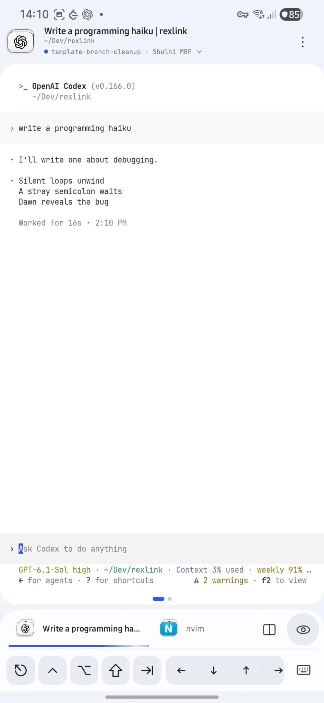
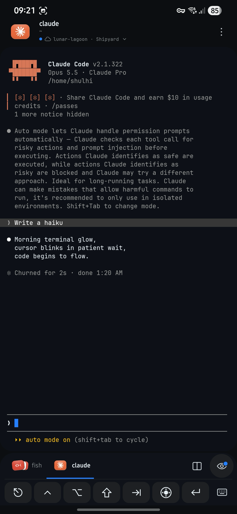

#  Rexlink

Unofficial native Android client for Superlogical Rex.
Connect directly to your authenticated Rex server over your private Tailscale network.
Kotlin/Compose supplies the UI; Rust handles the Rex protocol and JNI; libghostty-vt
maintains terminal state. No custom bridge, proxy or Rex subprocess is required.

| Light theme | Dark theme |
| :---: | :---: |
|  |  |

```text
rexlink/
├── rexlink-android/       Android Studio / Gradle app, UI, rendering and input
└── rexlink-core/          Rust workspace, shared protocol and terminal implementation
    ├── src/              rexlink-core crate
    ├── jni/              rexlink-jni crate; exports the existing librex_android ABI
    ├── probe/            original rex-probe / rex-view investigation CLI and evidence
    ├── native/           Ghostty shim, pinned source manifest and MIT license
    └── scripts/          native build helper
```

The probe keeps its original investigation implementation and evidence for protocol
experiments. The app uses the maintained `rexlink-core` crate, through `rexlink-jni`.
The crate alias inside JNI remains `rex_core`; Android's package `dev.shulhi.rex`
and native-library name are unchanged, preserving installed app data and updates.

## Install on Android

Rexlink currently supports **64-bit ARM phones running Android 9 or newer**,
including the Galaxy S22+. You need access to an existing Rex server. Install
and connect Tailscale on your phone when the server is on a private tailnet.
Rexlink uses that existing VPN connection; it does not embed another VPN.

Obtain the release APK from the project maintainer, or build it below. Open the
APK on your phone and allow installation from that file/browser app when Android
asks. Alternatively, enable USB debugging, connect and authorize your device,
then install with Android SDK platform-tools:

```sh
adb devices -l
adb -s <your-device-serial> install -r Rexlink-0.1.0-arm64-release.apk
```

Open **Rexlink**, enter your Rex server's authenticated private HTTPS URL, and
connect. Add other hosts under **⋮ → Servers**. Keep Tailscale connected and
ensure Rexlink is included in its VPN routing. The app does not configure a Rex
server or change its authentication. APKs are not yet published to an app store.

## Build and install from source

```sh
git clone <repository-url> rexlink
cd rexlink
```

Replace `<repository-url>` with the Git URL where you host this repository.


Install Android Studio, Android SDK platform 37, Build Tools 36.0.0, NDK
30.0.16248370, Rust 1.93 or newer, Python 3.9+, and curl. Android Studio's bundled
JDK 25 was used for validation. See [BUILDING.md](BUILDING.md) for setup, host
tests, debug builds, device installation and platform details.

From this repository root:

```sh
./rexlink-android/scripts/gradle.sh :app:assembleRelease
```

To install the APK you just built:

```sh
adb devices -l
adb -s <your-device-serial> install -r \
  rexlink-android/app/build/outputs/apk/release/app-release.apk
```

The build downloads checksum-verified Ghostty and Zig, compiles the Rust JNI
library for Android arm64, and builds the APK. The first build needs network
access; later builds reuse ignored local caches. No old sibling checkout is needed.

```text
rexlink-android/app/build/outputs/apk/release/app-release.apk
```

Open **rexlink-android/** in Android Studio, rather than the repository root.
Release builds are optimized and non-debuggable. This prototype currently uses
the development signing identity; see the build guide before publishing a release.

## Run

Keep Tailscale connected on the phone and enter your Rex server's private HTTPS
address. Add hosts under **⋮ → Servers**. The header cycles through sessions
across connected hosts; the terminal card switches panes. Both loop at the ends.
The bottom dock switches
tabs and opens pane options or Activity. Rename a session from its row’s
**⋮ → Rename session** in the session list; changes sync through Rex.
The selected pane streams a Ghostty
snapshot followed by incremental VT output. Opening a pane claims it once when
ready; viewing another client's pane shows a contextual takeover notice. Manual
Take/Release remain in the overflow menu. Input is paused during reconnection and
uncertain input is never replayed.

Enable **⋮ → Background alerts** to receive attention notifications while the app
is backgrounded or the phone is locked. Allow notifications when Android asks.
A quiet ongoing notification shows monitoring status and a **Stop** action.
Only input/approval/sign-in requests and errors alert; running and finished tasks
do not. Tapping an alert opens its server, session and pane. Terminal control is
released and rendering pauses in the background; monitoring is read-only.

Monitoring stops when you remove Rexlink from Recents, force-stop it, or tap Stop.
It does not start at boot or require server-side push. Network loss, Android Doze
and device battery management can delay alerts; instant delivery is not guaranteed.

See [Android usage](rexlink-android/README.md),
[protocol findings](rexlink-android/PROTOCOL.md), and
[validation history](rexlink-android/VALIDATION.md).

## Project status

Rexlink is maintained on a **best-effort basis**. Support, updates, bug fixes and
compatibility with future Rex versions are not guaranteed. Use it at your own
risk: it is provided **AS IS, without warranties or conditions of any kind**.
The warranty disclaimer and limitations of liability are set out in the
[Apache 2.0 license](LICENSE).

## History and license

Both original repositories' histories are retained without rewriting their commit
IDs. See [HISTORY.md](HISTORY.md) for provenance and history-navigation commands.

Copyright 2026 Shulhi Sapli and contributors. Project code is licensed under
[Apache License 2.0](LICENSE). Third-party code, fonts, logos and sourced assets
retain their own terms; see [THIRD_PARTY_NOTICES.md](THIRD_PARTY_NOTICES.md).
Rexlink is an independent, unofficial client and is not an official Rex product.
