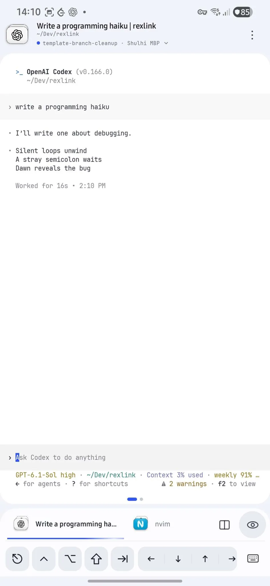
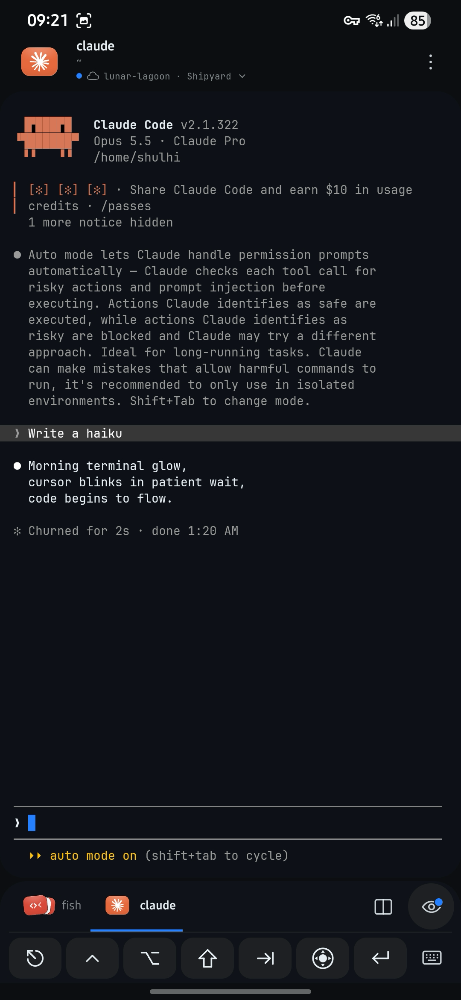

#  Rexling

## Overview

Rexling is an unofficial native Android client for Superlogical Rex.
Access your terminal sessions from your phone or tablet, with touch controls
for everyday shell work, Neovim, Codex and Claude.

| Light theme | Dark theme |
| :---: | :---: |
|  |  |

## Installation and build

Rexling supports **Android 9 or newer on 64-bit ARM devices**. You need a running
Rex server. Connect through your phone’s Tailscale VPN, optional built-in Tailscale,
or SSH.

### Install an APK

Download an APK from [GitHub Releases](https://github.com/shulhi/rexling/releases),
open it on your phone, and allow installation when Android asks. Open Rexling
and enter your Rex server’s private HTTPS URL or `ssh://user@host`. On Android 17+, allow local
network access when prompted.

### Build from source

Install Android Studio, the Android SDK/NDK, Rust, Go, Python and curl. Exact versions
and setup instructions are in [BUILDING.md](BUILDING.md).

```sh
git clone https://github.com/shulhi/rexling.git
cd rexling
./rexling-android/scripts/gradle.sh :app:shareRelease
```

The build downloads the pinned native dependencies and produces an APK and
SHA-256 checksum in `rexling-android/dist/`. Open `rexling-android/` in Android
Studio to work on the app.

## Features

- **Connection options** — SSH with encrypted key storage or keyless Tailscale SSH,
  optional built-in Tailscale and custom Headscale control servers. [Connection setup](docs/connections.md)
- **Servers and sessions** — connect to multiple Rex servers, create and rename
  sessions, and restore your last session, tab and pane.
- **Tabs and panes** — put tabs at the bottom or in a sidebar. Create tabs with
  **+** in the sidebar or on medium and wide bottom layouts. Rename and reorder
  terminals, preview layouts, split right or below, and dock or float panes.
- **Foldables and tablets** — show up to four tiled panes at once on supported
  full-screen layouts. Floating panes can sit over tiled terminals on unfolded
  foldables.
- **Floating pane dock** — hold and drag the dock to move it. Tap it to open a
  pane or fan out a group. The dock shows the pane count and unread activity,
  and panes animate into and out of it.
- **Automatic pane takeover** — opening a pane takes control and resizes its
  terminal to fit your screen, letting terminal applications reflow their text.
- **Kitty graphics** — display terminal images through libghostty, including
  PNG/RGB/RGBA images, transparency and animation. Images restore with the
  terminal snapshot when reconnecting.
- **Keyboard and touch controls** — customize the keyboard toolbar and Ctrl
  shortcuts. Use the arrow joystick, navigation popup, function keys, and
  Neovim shortcuts in a wheel or grid.
- **File and image uploads** — attach files or paste images with upload progress
  and cancellation. Rex inserts the uploaded path into the destination terminal.
  Requires Rex API revision 11 or newer.
- **Port forwarding** — open remote TCP services in your phone’s browser, with
  automatic reconnection and background forwarding. Requires Rex API revision 14
  or newer.
- **Activity and notifications** — track working tasks, finished tasks and
  requests for attention. Unread dots identify tabs and floating panes with
  new activity, with optional background alerts.
- **Display options** — light, dark and system themes, a compact top bar that
  can follow the keyboard, immersive mode, program icons and frosted overlays.

See the [Android guide](rexling-android/README.md) for more details.

## Project status and license

Rexling is an independent, unofficial client maintained on a **best-effort basis**.
Compatibility with future Rex versions and ongoing support are not guaranteed.
The app is provided **AS IS**, under the terms of the license.

Copyright 2026 Shulhi Sapli and contributors. Project code is licensed under
[Apache License 2.0](LICENSE). Third-party dependencies and assets retain their
own terms, listed in [THIRD_PARTY_NOTICES.md](THIRD_PARTY_NOTICES.md).
